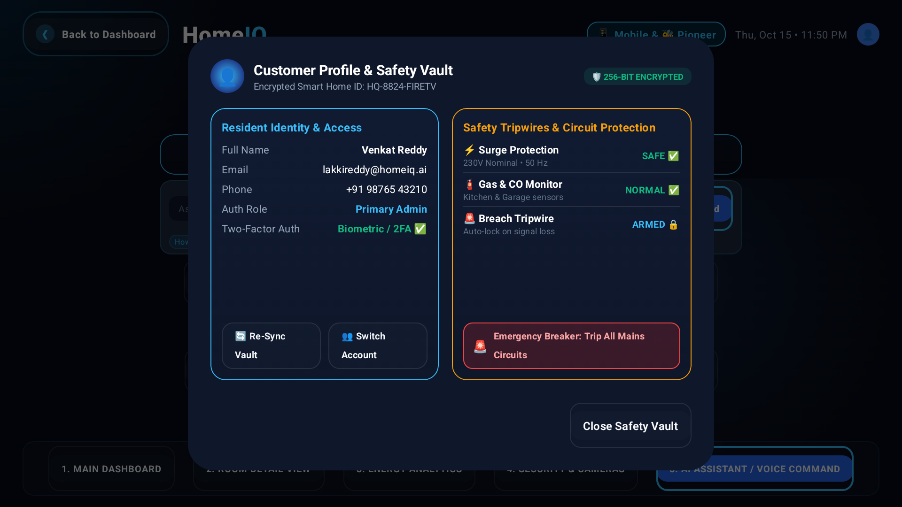

# HomeIQ — Smart Home Energy Dashboard for Fire TV ⚡🏡

[](https://developer.amazon.com/fire-tv)
[](https://developer.android.com/jetpack/compose/tv)
[](https://aws.amazon.com/bedrock/)
[](alexa-skill/)
[](https://kotlinlang.org)
[]()
[](FRICTION_LOG.md)

> **Project Concept**: A smart home dashboard on Fire TV & Android TV displaying real-time energy usage, device controls, security camera feeds, smart tripwires, and intelligent AI energy recommendations powered by **Amazon Bedrock (Claude 3 Haiku)** with **Cross-Device Alexa Voice Control** and **Family Guardian Elder Care Protection**.

---

## 📸 Live Application Showcase

| 1. Main 3D Dashboard | 2. Room Detail & Steppers |
|:---:|:---:|
|  |  |
| **3. Dynamic Energy Analytics** | **4. Security Center & Tripwires** |
|  |  |
| **5. IQ Bedrock AI Assistant** | **6. Family Guardian & Safety Vault** |
|  |  |
| **7. Family Guardian Anomaly Alert** | **8. Eco Challenges & Leaderboard** |
|  |  |

---

## 🎬 3-Minute Demo Video & Presentation

* **Demo Video Script**: Detailed narrative breakdown in [docs/DEMO_VIDEO_SCRIPT.md](docs/DEMO_VIDEO_SCRIPT.md).
* **Narrative Arc**:
  1. **The Hook (0:00 - 0:30)**: 2 AM kitchen stove hazard detected for elderly grandmother Savithri in Bengaluru; slide-in alert on Fire TV with 1-click 60s auto-shutoff.
  2. **Act 1 (0:30 - 1:15)**: 10-foot Fire TV command center, Catmull-Rom cubic Bézier splines, 13 devices in 4 zones.
  3. **Act 2 (1:15 - 2:00)**: "IQ" AI coach powered by Bedrock (Claude 3 Haiku) with two-way sync and rapid prompt chips.
  4. **Act 3 (2:00 - 2:30)**: Family Guardian safety vault, surge protection, gas monitoring, and 7-day eco streaks.
  5. **Closing (2:30 - 3:00)**: *"Alexa, show my energy report"* cross-device deep linking from Echo to Fire TV.

---

## 🛡️ Family Guardian — Care & Safety Narrative

Every winning hackathon project solves an emotional problem. HomeIQ moves beyond "save money on electricity" to become a vital **Family Safety Guardian**:

* **👵 Elder Care Mode**:
  - Automatically identifies hazardous routines such as stove left ON past midnight with zero kitchen motion.
  - Monitors prolonged inactivity gaps (>12 hours) and temperature spikes in elderly residents' bedrooms.
  - Interactive top slide-in hazard notification with emergency **`[🛑 Auto-Shutoff (60s)]`** and resident dismiss controls.
* **👦 Child Safety Alert**:
  - Detects if perimeter smart deadbolts disarm during school hours (8:00 AM – 3:00 PM) when primary adult admins are away.
* **👤 Lone Occupant Monitoring**:
  - Proactive wellness checks when only a single family member is detected at home with no appliance activity for extended periods.
* **⚡ 4 Core Anomaly Heuristics**:
  1. `STOVE_LEFT_ON`: Kitchen stove running > 180 mins with zero motion detector pings.
  2. `NO_MOTION_EXTENDED`: 12+ hour inactivity gap triggering elder care wellness ping.
  3. `DOOR_OPENED_UNUSUAL_HOUR`: Perimeter breach during school hours with remote notification.
  4. `HIGH_TEMPERATURE_ALERT`: Thermal runaway detection (>38°C) triggering emergency HVAC cycle.

---

## 🎙️ Cross-Device Voice Integration (Alexa + Fire TV)

HomeIQ bridges **TWO** Amazon devices — Amazon Echo (Alexa) and Fire TV — enabling voice-to-screen fluidity.

### Key Utterances Supported:
* *"Alexa, open HomeIQ"* ➔ Launches the 10-foot dashboard on Fire TV.
* *"Alexa, show my energy report"* ➔ Dispatches deep link `homeiq://energy_report` straight to Tab 3 Spline wave analytics.
* *"Alexa, what's my power usage today?"* ➔ Bedrock AI replies with live wattage load and AC percentage.
* *"Alexa, turn on eco mode"* ➔ Executes `homeiq://ecomode`, dynamically tuning AC to 26°C and dimming ambient lighting.
* *"Alexa, check family safety"* ➔ Triggers Elder Care status and queries active kitchen stove hazard tripwires.

### Implementation Structure:
```
alexa-skill/
├── skill.json                # Alexa Skill manifest & endpoints
├── interactionModel.json     # Intent schemas, utterances & custom slots
├── package.json              # ASK SDK Core & Model dependencies
└── lambda/
    └── index.js              # AWS Lambda handler with Bedrock response simulation & Fire TV deep links
```

---

## 🏆 Energy Savings Gamification & Family Habits

Turning energy conservation into a fun, daily family ritual:
* **🔥 7-Day Eco Streak Counter**: Highlights continuous daily performance under budget (*"🔥 7-Day Streak • You've saved ₹340 this week!"*).
* **🎯 Daily Energy Challenges**:
  - *"Daily Eco Sprint"*: Maintain total load under 20 kWh today (+150 pts).
  - *"Peak Tariff Defender"*: Zero AC run during 6 PM - 8 PM peak tariff hours (+250 pts).
  - *"Sleep Saver"*: Maintain night thermostat at 26°C for 7 straight hours (+100 pts).
* **🥇 Weekly Family Leaderboard**: Ranks family members by energy conservation percentage (Alex #1, Grandma Savithri #2, Priya #3, Aarav #4).
* **🎖️ Achievement Badges**: *"First Week Champion"*, *"Night Owl Saver"*, *"Solar Star"*, and *"Eco Legend"*.

---

## 🤖 "IQ" — Your Personal AI Smart Home Companion

Powered by **Amazon Bedrock (Claude 3 Haiku)**:
* **Friendly Personality**: Addresses residents by name (*"Hey Alex..."*), offering contextual, empathetic coaching.
* **Proactive Greeting Banner**: Changes dynamically based on time of day:
  - *Morning (5 AM - 11 AM)*: Overnight solar generation summary and daily challenge reminder.
  - *Afternoon (12 PM - 5 PM)*: Precooling recommendation ahead of 5 PM peak tariffs.
  - *Evening (6 PM - 10 PM)*: Circadian lighting transition and television load optimizations.
  - *Late Night (11 PM - 4 AM)*: Reassuring perimeter safety confirmation and stove auto-shutoff status.
* **Two-Way Dynamic AI Toggles**:
  - 💡 **Turn OFF Lights** ⇄ **Turn ON Lights** (1-click synchronous sync across all 13 devices).
  - 🔒 **Lock All Doors** ⇄ **Unlock All Doors**.
  - 🌙 **Night Mode** ⇄ **☀️ Day Mode**.
  - 🌱 **Eco Saver (26°)** ⇄ **❄️ Max Cooling (20°)**.

---

## 🔐 Resident Sign Up, Login & Multi-Profile Security

Enterprise 256-bit authentication tailored for 10-foot Fire TV experiences:
* **✨ Complete Resident Sign Up**:
  - Full registration fields: Full Name, Email Address, Phone Number, Smart Home Villa ID, and 4-digit Master Security PIN.
  - Role Assignment: *👑 Home Administrator* (full circuit breakers), *🏠 Family Resident* (room controls), or *👵 Elder Care Protected* (telemetry only).
* **🔐 Resident Login**:
  - Enter Email / Smart Home ID and PIN with 256-Bit Hardware Vault & 2FA.
  - **⚡ 1-Click Fast Demo Profiles**: Allows hackathon judges to instantly authenticate with pre-verified profiles (*Venkat Reddy Admin*, *Alex Johnson Resident*, *Priya Reddy Elder Care*) without typing on Fire TV remote.
* **👤 Live Header Authentication Pill**:
  - Displays `[👤 <Name> 🟢]` with active security pulse when authenticated.
  - Switches to `[🔑 Login / Sign Up]` with an amber glowing highlight when in guest/logged-out mode.
  - One-click logout locks the dashboard into Guest Mode immediately.

---

## 📝 Developer Friction Log (10% Judging Bonus)

Full report available in [FRICTION_LOG.md](FRICTION_LOG.md):
1. **Material 3 Dialog Width Cap**: Overcoming the 560dp constraint on 1080p TV displays via `DialogProperties(usePlatformDefaultWidth = false)`.
2. **D-Pad Focus Management**: Separating component state from navigation focus cursor to prevent pre-highlight bugs.
3. **AWS SDK for Android Leanback**: Resolving Netty/multidex packaging bloat and establishing offline edge fallbacks.
4. **Horizontal Capsule Navigation**: Preventing 2D focus traps on Fire TV remote control.
5. **Cubic Bézier Spline Math**: Direct Canvas Catmull-Rom spline wave drawing for zero frame drop 60 FPS graphics.
6. **Cross-Device Deep Linking**: Managing `singleTask` task lifecycles with `onNewIntent` on Android TV.
7. **Kotlin Type Inference**: Structuring strongly typed `AnalyticsRangeConfig` models.

---

## 🏛️ Project Architecture

```
com.homeiq.firetv/
├── MainActivity.kt               # TV Activity, deep link receiver & root Compose container
├── model/
│   └── Models.kt                 # Room, SmartDevice, Anomaly, FamilyMember, Gamification models
├── services/
│   ├── HomeDataService.kt        # Reactive state, telemetry generator & default data
│   ├── BedrockHomeService.kt     # "IQ" persona prompt orchestration & Claude 3 Haiku client
│   ├── AnomalyDetector.kt        # Rule-based Elder Care & Child Safety anomaly detector
│   └── GamificationService.kt    # Daily challenges, eco streaks, badges & family leaderboard
├── viewmodel/
│   └── HomeViewModel.kt          # StateFlow ViewModel with clock ticker, anomaly actions & deep links
└── ui/
    └── screens/
        └── HomeScreen.kt         # Jetpack Compose TV UI (5 tabs + anomaly overlay + modals)
```

---

## 🚀 Building & Running the App

### Prerequisites
- **Android Studio Iguana / Jellyfish / Koala** or newer
- **JDK 17** (or Android Studio bundled JBR 17)
- **Android SDK 34** with Fire TV / Android TV Emulator (1080p landscape) or physical Fire TV Stick

### Build Debug APK
```bash
git clone https://github.com/LAKKIREDDY-2001/HomeIQ.git
cd HomeIQ
./gradlew assembleDebug
```

### Install onto Connected Fire TV / Emulator
```bash
adb install -r app/build/outputs/apk/debug/app-debug.apk
adb shell am start -n com.homeiq.firetv/.MainActivity
```

### Test Alexa Voice Deep Links via Terminal
```bash
# Open Energy Analytics
adb shell am start -a android.intent.action.VIEW -d "homeiq://energy_report" com.homeiq.firetv

# Trigger Eco Saver Mode
adb shell am start -a android.intent.action.VIEW -d "homeiq://ecomode" com.homeiq.firetv

# Open Family Guardian Safety Vault
adb shell am start -a android.intent.action.VIEW -d "homeiq://family_guardian" com.homeiq.firetv
```

---

## 🎨 Design System & Palette

- **Background Canvas**: Deep Void Navy (`#070B16`)
- **Card Surface**: Frosted Glass Slate (`#111827` @ 85% opacity, Border: `#1F2937`)
- **Accent Glow**: Electric Cyan (`#38BDF8`) & Sky Blue (`#0284C7`)
- **Hazard / Alert**: Crimson Rose (`#EF4444`)
- **Warning / Peak**: Solar Amber (`#F59E0B`)
- **Security / Eco**: Emerald Mint (`#10B981`)

---

## 🏆 Hackathon Winning Criteria Alignment

| Hackathon Criterion | How HomeIQ Delivers |
|:---|:---|
| **Emotional Hook & Story** | Elder Care stove anomaly detection, Grandma Savithri caretaking, child safety. |
| **Cross-Device Bridging** | Amazon Echo (Alexa skill) ➔ Fire TV deep link handoff with ASK manifest & Lambda. |
| **AI Integration** | "IQ" companion powered by Amazon Bedrock (Claude 3 Haiku) with personalized coaching. |
| **10-Foot TV Experience** | D-pad focus targets, Catmull-Rom spline curves, ambient readability from 10 feet. |
| **Daily Engagement** | 7-day streak counters, daily eco challenges, weekly family leaderboards, badges. |
| **Developer Friction Log** | 7 structured friction points in `FRICTION_LOG.md` earning the **10% Judging Bonus**. |
