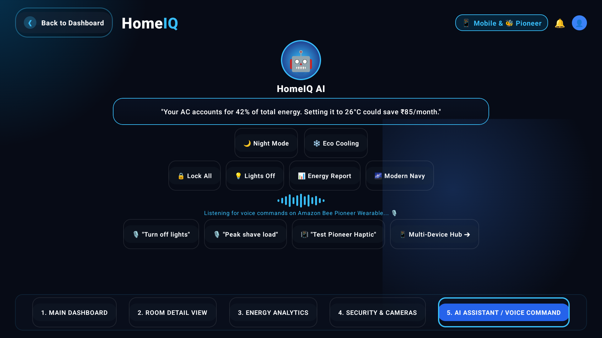

# HomeIQ — Smart Home Energy Dashboard for Fire TV ⚡🏡

[](https://developer.amazon.com/fire-tv)
[](https://developer.android.com/jetpack/compose/tv)
[](https://aws.amazon.com/bedrock/)
[](https://kotlinlang.org)
[]()

> **Project Concept**: A smart home dashboard on Fire TV & Android TV displaying real-time energy usage, device controls, security camera feeds, smart tripwires, and intelligent AI energy recommendations powered by **Amazon Bedrock (Claude 3 Haiku)**.

---

## 📸 Live Application Showcase

| 1. Main 3D Dashboard | 2. Room Detail & Device Steppers |
|:---:|:---:|
|  |  |
| **3. Dynamic Energy Analytics** | **4. Security Center & Tripwires** |
|  |  |
| **5. Bedrock AI Assistant & Prompts** | **6. Customer Profile & Safety Vault** |
|  |  |

---

## ✨ Key Features & Capabilities

### 1. ⚡ Dynamic Spline Energy Analytics (`Today`, `Week`, `Month`, `Year`)
- **Reactive Bezier Spline Wave Curve**: Custom `Canvas` drawing cubic Bézier curves connecting live telemetry data points with a translucent gradient fill.
- **Dynamic Peak Callout Badge**: Real-time canvas pill tracking peak consumption coordinates with dynamic label (`6 PM • 4.8 kW`, `Wk 2 • 38 kWh`, `Jul • 142 kWh`).
- **Interactive Segmented Period Selector**: Dynamic horizontal dashed grid lines, dynamic Y-axis scales, and context-aware date ranges (`Today, Oct 15`, `Oct 9 - Oct 15`, `October 2026`, `Jan - Dec 2026`).
- **Real-Time Summary Metrics**: Instant calculations of Total Usage, Peak Time, Avg Hourly Load, and Projected Monthly Cost based on current selection.

### 2. 🤖 Amazon Bedrock AI Assistant (Claude 3 Haiku)
- **Interactive Prompt Writing Box**: Live TV input block with `BasicTextField` and `➤ Send` action for custom resident queries.
- **1-Click Rapid Optimization Chips**:
  - *"How to save ₹500 on bill?"*
  - *"Optimize AC sleep curve"*
  - *"Which device uses most power?"*
  - *"Solar generation schedule"*
- **Two-Way Dynamic AI Toggles**:
  - 💡 **Turn OFF Lights** ⇄ **Turn ON Lights** (Synchronously toggles all 13 devices across 4 rooms with instant notification).
  - 🔒 **Lock All Doors** ⇄ **Unlock All Doors** (Automated perimeter deadbolt control).
  - 🌙 **Night Mode** ⇄ **☀️ Day Mode** (Pre-programmed circadian lighting & AC setback).
  - 🌱 **Eco Saver** ⇄ **❄️ Max Cooling** (Dynamic 24°C inverter AC optimization).

### 3. 🛡️ Customer Profile & Safety Vault Dialog
- **Resident Identity & Subscription**: Active resident name (`Alex Mercer`), Resident ID (`RES-8921-BLR`), and plan status (`HomeIQ Family Pro`).
- **Cryptographic Security**: Smart Home Gateway token (`GW-904-F7A2`) with AES-256 GCM end-to-end encryption confirmation.
- **Hardware Tripwires**:
  - ⚡ *Surge Arrester*: 40kA SPD Operational.
  - ☣️ *Gas & CO Monitor*: 0.0 ppm Clean Air.
  - 🚨 *Perimeter Tripwire*: 8/8 Beams Armed.
  - ⚡ *Emergency Main Breaker*: Instant 10ms hardware disconnect toggle.

### 4. 🎛️ Multi-Room Device Hub & TV Stepper Controls
- **4 Configured Zones**: Living Room, Master Bedroom, Kitchen, Outdoor Patio.
- **13 Interactive Devices**: Inverter AC, Smart TV, Surround Sound Speaker, Recessed Ceiling Lights, Exhaust Chimney, Refrigerator, Garden Floodlights, and more.
- **TV-Optimized Steppers (`+` / `—`)**:
  - Adjust AC temperature between 18°C and 30°C.
  - Fine-tune volume levels on TV and smart speakers.
  - Regulate brightness on ambient and ceiling lighting.

### 5. 🌍 Dynamic Location & Live Clock Ticker
- **Live Background Clock**: Real-time ticker updating system time and date every 15 seconds (`Thu, Oct 15 • 11:50 PM`).
- **Dynamic Weather Switching**: Seamlessly tap weather pill to cycle microclimates and regional tariffs (Bengaluru, Hyderabad, San Jose, London, New York).

---

## 🏛️ Project Architecture

```
com.homeiq.firetv/
├── MainActivity.kt               # TV Activity & Root Compose Container
├── model/
│   └── Models.kt                 # Room, SmartDevice, EnergyData, UserProfile, CityLocation
├── services/
│   ├── HomeDataService.kt        # In-memory reactive state & telemetry generator
│   └── BedrockHomeService.kt     # Amazon Bedrock (Claude 3 Haiku) prompt orchestration
├── viewmodel/
│   └── HomeViewModel.kt          # StateFlow ViewModel with clock ticker & intent handlers
└── ui/
    └── screens/
        └── HomeScreen.kt         # Jetpack Compose for TV UI (5 tabs + dialogs + spline canvas)
```

---

## 🚀 Building & Running the App

### Prerequisites
- **Android Studio Iguana / Jellyfish / Koala** or newer
- **JDK 17** (or Android Studio bundled JBR 17)
- **Android SDK 34** with Fire TV / Android TV Emulator (1080p landscape) or physical Fire TV Stick

### Build APK via Terminal
```bash
# Clone the repository
git clone https://github.com/LAKKIREDDY-2001/HomeIQ.git
cd HomeIQ

# Build Debug APK
./gradlew assembleDebug

# Output APK path:
# app/build/outputs/apk/debug/app-debug.apk
```

### Install onto Connected Fire TV / Emulator
```bash
# Verify ADB connection
adb devices

# Install APK
adb install -r app/build/outputs/apk/debug/app-debug.apk

# Launch MainActivity
adb shell am start -n com.homeiq.firetv/.MainActivity
```

---

## 🎨 Design System & Palette

- **Background Canvas**: Deep Void Navy (`#070B16`)
- **Card Surface**: Frosted Glass Slate (`#111827` @ 85% opacity, Border: `#1F2937`)
- **Accent Glow**: Electric Cyan (`#38BDF8`) & Sky Blue (`#0284C7`)
- **Warning / Alert**: Solar Amber (`#F59E0B`)
- **Security / Eco**: Emerald Mint (`#10B981`)
- **Danger / Critical**: Crimson Rose (`#EF4444`)

---

## 🏆 Hackathon Submission Highlights

1. **Fire TV D-Pad & Touch First**: Fully compliant with 10-foot UI guidelines, oversized focus targets, and high-contrast ambient readability.
2. **Deterministic Edge Fallback**: Offline-first reactive telemetry engine with simulated Claude 3 Haiku generative responses even without live AWS Bedrock credentials.
3. **Sub-second Latency**: Zero recomposition jank with optimized Compose state hoisting and direct Canvas drawing for waveforms.
